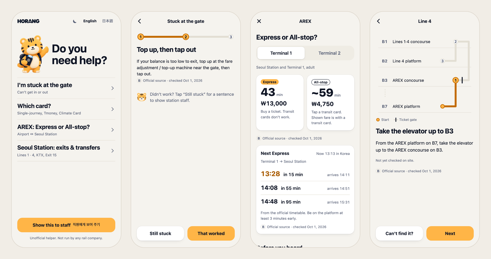
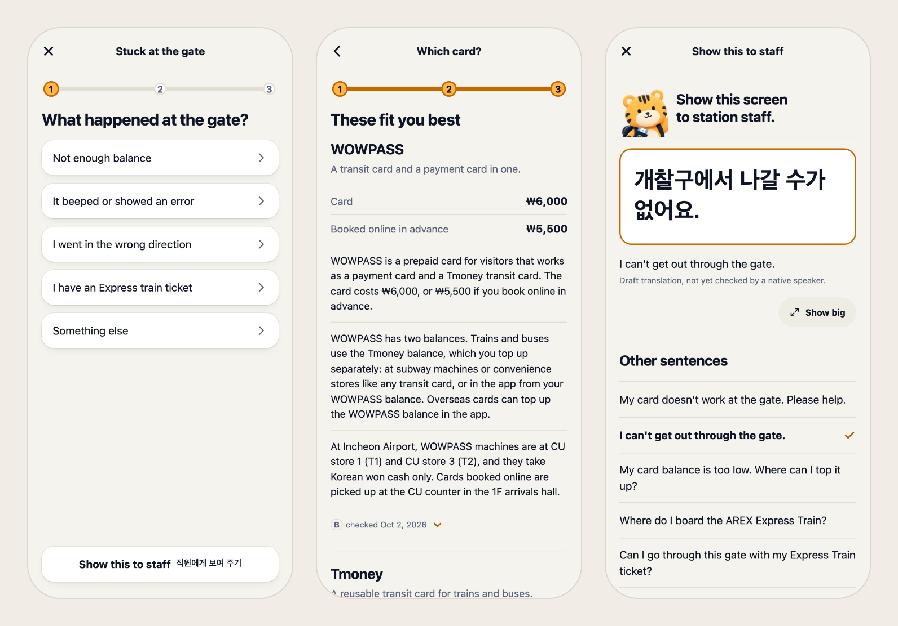
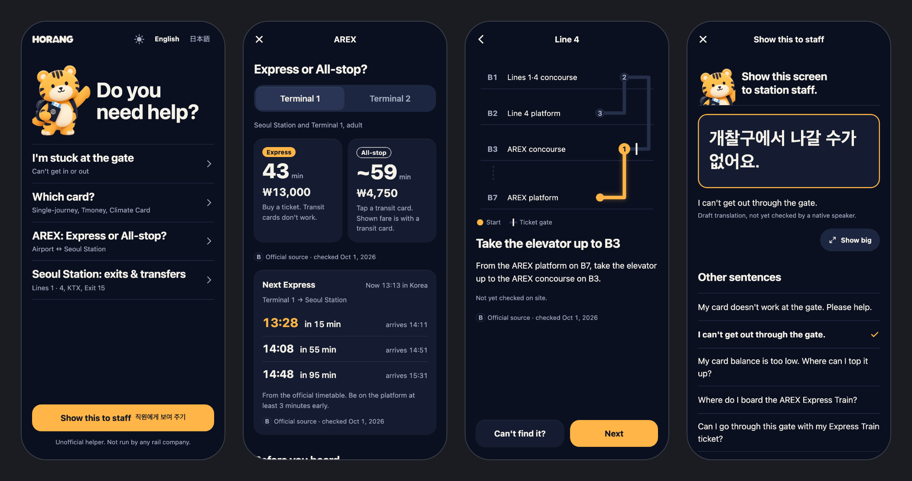

# Horang

[한국어](README.md) · **English**


**An offline full-trip companion for travelers in Korea.** From your first hour landing at Incheon Airport and riding AREX to Seoul Station, to navigating Hongik Univ., Myeong-dong, Gangnam, and Seongsu, riding cashless buses and taxis, ordering at restaurant kiosks with allergy/vegan Korean cards, and handling pharmacies, lost items, City Airport Terminal check-in, and tax refunds.

**Live:** https://horang.seungwoo7050.workers.dev · 7 languages (`English` · `日本語` · `简体中文` · `繁體中文` · `Français` · `Español` · `Română`)

> Unofficial helper. Not run by or affiliated with any rail company (AREX, Korail, Seoul Metro) or Incheon Airport.

<p align="center">
  Next.js 16 (static export) · React 19 · TypeScript · zod · Cloudflare Workers · Playwright<br>
  October 2026 · 158 commits · about 180 tests
</p>

<p align="center"></p>

## What it does

| Screen                                      | Helps with                                                                                                                         |
| ------------------------------------------- | ---------------------------------------------------------------------------------------------------------------------------------- |
| **I'm stuck at the gate**                   | Pick the cause (low balance, error beep, wrong direction, Express ticket), follow the fix, or show staff a sentence                |
| **Which card?**                             | Single-journey card, T-money or Climate Card, depending on where you are and how much you'll ride                                  |
| **AREX: Express or All-stop?**              | Time and fare side by side, the next trains from the official timetable, and a departure-day mode                                  |
| **Seoul & Hub Stations: exits & transfers** | Elevator routes for luggage at Seoul Station, Hongik Univ., Myeong-dong, Gangnam, and Seongsu, drawn floor by floor                |
| **City bus & taxi guide**                   | Front-door boarding / rear-door tap-out rules, 30-min transfers, cashless bus warning, and full-screen taxi driver cards           |
| **Dining, kiosks & dietary cards**          | Kiosk `010` phone prompt bypass, foreign IC card tips, and Korean allergy, halal, and strict vegan cards                           |
| **Pharmacy, lost item & departure**         | Symptom cards for pharmacies (`약`), 119/LOST112 links, T-Locker/T-Luggage, Seoul Station B2 City Airport Terminal, and Tax Refund |
| **Show this to staff**                      | Short Korean sentences in big type, a full-screen "Show big" view, and the 1330 Korea Travel Helpline                              |

- **Works offline** after the first visit (service worker precache), including timetables and maps.
- **No sign-up, no account, no backend, no tracking.** A static site.
- **Every fact carries its source**: each claim is graded A (checked on site), B (official source) or C (traveler reports) with the date it was last checked.
- Light and dark, Reduce Motion, forced colors and screen readers are tested.

<p align="center"></p>

## How it's built

- **Next.js 16** static export (`output: "export"`), **React 19** with view transitions, **Tailwind CSS v4** and **shadcn/ui** primitives over the `B · Night arrival` design tokens.
- **Content**: `src/content/claims.json` (58 facts with evidence grades and sources), `phrases.json` (34 staff/driver/dining/pharmacy sentences), `timetables.json` (official AREX Express timetable), `links.json` (7 registered external links).
- **i18n**: 7 languages (`en`, `ja`, `zh-CN`, `zh-TW`, `fr`, `es`, `ro`) with 100% key parity.
- **Hosting**: Cloudflare Workers static assets (`wrangler.jsonc`). Only `out/` is uploaded, with no Worker script.

```
src/app/[lang]/     screens (gate, card, arex, station, transit, dining, emergency, staff)
src/components/     flows, route map, "Show big", brand images, ui/ (shadcn primitives)
src/content/        claims, phrases, timetables, links and the zod schema
src/station-map/    Seoul Station & hub stations (Hongik, Myeong-dong, Gangnam, Seongsu) graphs
src/i18n/           7 language packs (en, ja, zh-CN, zh-TW, fr, es, ro)
scripts/            content check, source watch, service worker & CSP, harness guards (scripts/harness/)
e2e/                Playwright tests (flows, offline, CSP, a11y, next train, brand)
```

<p align="center"></p>

## Run it

Requires Node 22.

```bash
npm ci
npm run dev        # http://localhost:3000
```

| Command               | What it does                                                                               |
| --------------------- | ------------------------------------------------------------------------------------------ |
| `npm run verify:fast` | Content check, lint, typecheck, format check, unit tests (Vitest), harness & design guards |
| `npm run verify`      | `verify:fast` → static export (`out/`, `sw.js`, `_headers`) → full Playwright E2E suite    |
| `npm run deploy`      | Build and deploy `out/` to Cloudflare Workers static assets                                |

CI runs check → build → e2e on every pull request, and deploys `main` to Cloudflare when everything passes.

## Current status

Pre-release. The screens, offline support and deployment are done. Before a public launch:

- On-site checks at Seoul Station (routes, exits and elevators are B-grade from official sources today)
- Native-speaker review of the Korean staff sentences and the Japanese text (currently marked as drafts in the app)
- Field tests with travelers from abroad
