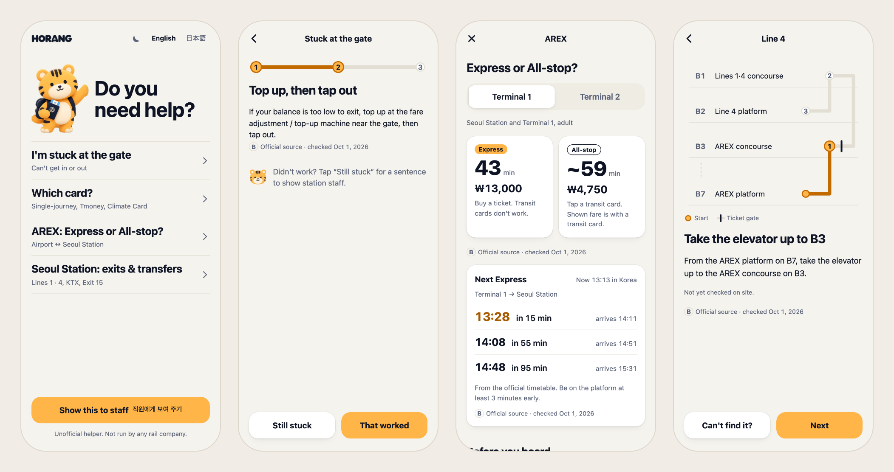
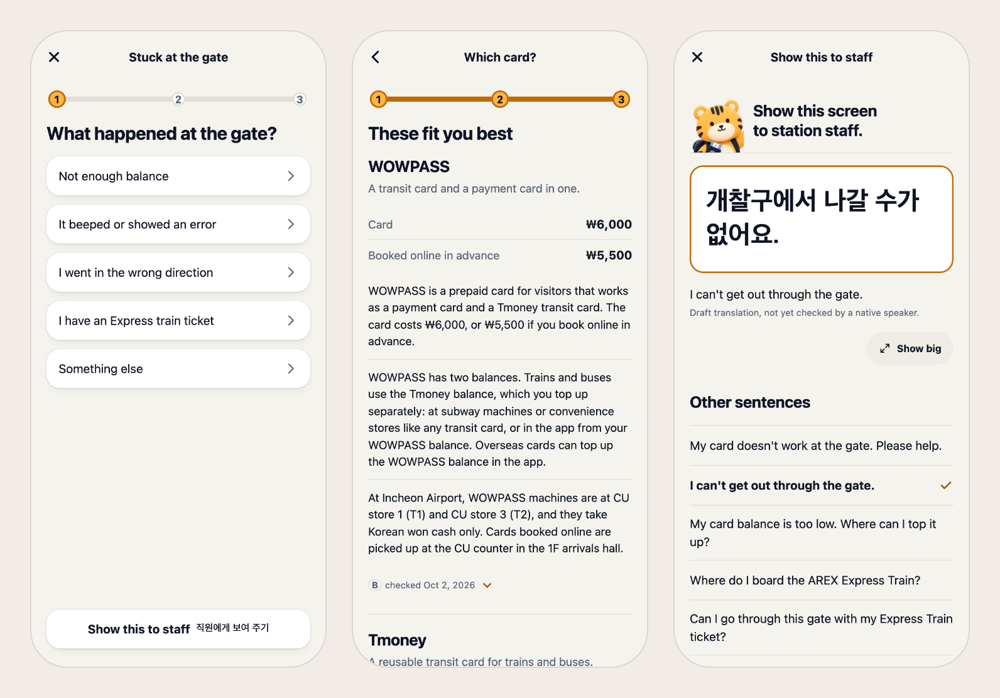
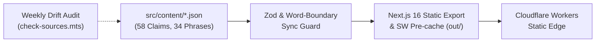
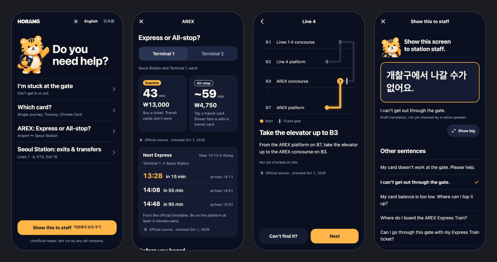

<p align="center">
  <h1 align="center">Horang</h1>
  <p align="center">An offline-first full-trip companion web application for international travelers in Korea</p>
  <p align="center"><a href="README.md">한국어</a> | <strong>English</strong> | <a href="https://horang.seungwoo7050.workers.dev">horang.seungwoo7050.workers.dev</a></p>
  <p align="center">Next.js 16 (Static Export) | React 19 | TypeScript | Zod | date-fns | nuqs | es-toolkit | Service Worker | Cloudflare Workers | Playwright</p>
</p>


From your first hour landing at Incheon Airport and riding AREX to Seoul Station, to navigating Hongik Univ., Myeong-dong, Gangnam, and Seongsu, riding cashless city buses and taxis, ordering at restaurant kiosks with allergy and vegan Korean cards, and handling pharmacies, lost items, City Airport Terminal check-in, and tax refunds. Available in 7 languages (`English`, `日本語`, `简体中文`, `繁體中文`, `Français`, `Español`, `Română`).

> Unofficial travel helper. Not operated by or affiliated with any rail company (AREX, Korail, Seoul Metro) or Incheon International Airport.

<p align="center"></p>

## Features

| Screen                                      | Helps with                                                                                                                                             |
| ------------------------------------------- | ------------------------------------------------------------------------------------------------------------------------------------------------------ |
| **I'm stuck at the gate**                   | Pick the cause (low balance, error beep, wrong direction, Express ticket), follow the fix step by step, or show staff a Korean card                    |
| **Which card?**                             | Choose between a single-journey card, T-money, or the Climate Card based on your current location and trip length                                      |
| **AREX: Express or All-stop?**              | Compare travel time and fares side by side, check the next trains from the official timetable, and switch to departure-day mode                        |
| **Seoul & Hub Stations: exits & transfers** | Step-free elevator routes for heavy luggage and strollers at Seoul Station, Hongik Univ., Myeong-dong, Gangnam, and Seongsu, drawn floor by floor      |
| **City bus & taxi guide**                   | Front-door boarding and rear-door tap-out rules, 30-minute transfer discounts, cashless bus notices, and full-screen taxi driver cards                 |
| **Dining, kiosks & dietary cards**          | Kiosk `010` phone prompt bypass, foreign IC card tips, and Korean allergy, halal, and strict vegan cards (including broth and salted seafood warnings) |
| **Pharmacy, lost item & departure**         | Symptom cards for pharmacies (`약`), 119 interpretation and LOST112 links, T-Locker/T-Luggage, Seoul Station B2 City Airport Terminal, and Tax Refund  |
| **Show this to staff**                      | Short Korean sentences in large type, a full-screen "Show big" view, and direct dialing to the 1330 Korea Travel Helpline                              |

- **Offline support**: Precaches timetables and floor-by-floor station maps via Service Worker after the first visit.
- **Static & private**: Runs without sign-up, accounts, a backend, or analytics tracking.
- **Source grading**: Each claim is graded A (verified on site), B (official source), or C (traveler reports) with its last-checked date.
- Tested across light and dark modes, Reduced Motion, forced colors, and screen readers.

<p align="center"></p>

## Architecture & Key Design Decisions



### 1. Evidence Grading (A/B/C) & Build-Time Claim Sync Guard (`assert-claim-sync`)

Fares, timetables, and transfer rules are maintained as 58 source-graded facts ([`src/content/claims.json`](src/content/claims.json)) and 34 on-site Korean communication cards ([`src/content/phrases.json`](src/content/phrases.json)), decoupled from UI layout code. At build time ([`scripts/check-content.mts`](scripts/check-content.mts)), Zod schemas and word-boundary regex guards (`hasNumber`, `assert-claim-sync` in [`src/content/schema.ts`](src/content/schema.ts)) verify that every numeric fare or duration in `claim.data` appears accurately across all 7 localized text strings, failing the build immediately on any mismatch. A weekly scheduled workflow ([`scripts/check-sources.mts`](scripts/check-sources.mts), [`scripts/sources-lib.mts`](scripts/sources-lib.mts)) audits upstream official pages for fare or schedule drift and can connect to a local `citeguard` (Qdrant + Ollama Hybrid RRF RAG) container to verify table-row and contextual changes beyond simple regex matching.

### 2. Static Export & Service Worker Precaching

To ensure instant loading in underground rail concourses or before a traveler activates roaming or a local SIM, Horang operates without a runtime backend. After `next build` generates the static export (`out/`), [`scripts/postbuild-lib.mts`](scripts/postbuild-lib.mts) hashes every route bundle, timetable, and station map into a content-addressed Service Worker precache manifest ([`scripts/sw.template.js`](scripts/sw.template.js)) and computes per-route SHA-256 inline script hashes to emit strict static Content Security Policy headers (`_headers`).

### 3. Floor-by-Floor Elevator Graph Navigation (`src/station-map/`)

Complex transfer hubs (Seoul Station ([`seoul-station.ts`](src/station-map/seoul-station.ts)), Hongik Univ., Myeong-dong, Gangnam, and Seongsu ([`hub-stations.ts`](src/station-map/hub-stations.ts))) are modeled as directed floor-and-lane graphs with typed edges (`walk`, `gate`, `elevator`). During build time, [`src/station-map/graph.ts`](src/station-map/graph.ts) validates node connectivity, vertical elevator constraints, and `claim` references (`validateStation`), then precomputes SVG cross-section coordinates and step progress boundaries (`layoutRoute`) so the browser renders step-free routes with zero client-side pathfinding overhead.

### 4. PR Preview Deployments & Bundle Budget Gate

To prevent precaching delays on slow roaming networks and underground platforms, a bundle budget gate ([`scripts/check-bundle-budget.mts`](scripts/check-bundle-budget.mts), [`src/lib/devops/synthetic-probe.ts`](src/lib/devops/synthetic-probe.ts)) enforces limits on single JS chunks (550KB), total precache volume (14MB), and verified presence of critical offline routes (`/`, `/en/gate/`, `/en/card/`, `/en/arex/`, `/en/station/`, `/en/transit/`, `/en/dining/`, `/en/emergency/`, `/en/staff/`, `/sw.js`, `/manifest.webmanifest`). On pull requests ([`.github/workflows/preview.yml`](.github/workflows/preview.yml)), the pipeline deploys a Cloudflare Workers preview alias (`pr-<number>`), runs W3C TraceContext (`traceparent`) synthetic probes across all 7 language routes, and logs cleanup tasks upon PR closure.

## Project Structure

- **Frontend & Styling**: **Next.js 16** static export (`output: "export"`), **React 19** with view transitions, **Tailwind CSS v4**, and **shadcn/ui** primitives over the `B - Night arrival` design tokens
- **Content**: `src/content/claims.json` (58 facts with evidence grades and sources), `phrases.json` (34 staff, driver, dining, and pharmacy sentences), `timetables.json` (official AREX Express timetable), `links.json` (7 registered external links)
- **i18n**: 7 languages (`en`, `ja`, `zh-CN`, `zh-TW`, `fr`, `es`, `ro`) with 100% key parity enforced at build time
- **Hosting**: Cloudflare Workers static assets (`wrangler.jsonc`), uploading only `out/` without a Worker runtime script

```text
src/app/[lang]/     screens (gate, card, arex, station, transit, dining, emergency, staff)
src/components/     flows, route map, "Show big", brand images, ui/ (shadcn primitives)
src/content/        claims, phrases, timetables, links and Zod schemas
src/station-map/    Seoul Station & hub stations (Hongik, Myeong-dong, Gangnam, Seongsu) graphs
src/lib/            next-train schedule math, URL flow history, bundle budget & synthetic probes (devops/)
src/i18n/           7 language packs (en, ja, zh-CN, zh-TW, fr, es, ro)
scripts/            content check, source watch, bundle budget check, service worker & CSP, static rule checks
e2e/                Playwright tests (flows, offline, CSP, a11y, next train, brand)
```

<p align="center"></p>

## Local Development & Verification

Requires Node 22.

```bash
npm ci
npm run dev        # http://localhost:3000
```

| Command               | Description                                                                                                        |
| --------------------- | ------------------------------------------------------------------------------------------------------------------ |
| `npm run verify:fast` | Content schema & sync check, lint, typecheck, format check, unit tests (Vitest), static rule & design token checks |
| `npm run check:budget` | Validates bundle budget (550KB JS chunk, 14MB total precache) and required offline routes on `out/`                |
| `npm run verify`      | Runs `verify:fast`, builds static export (`out/`, `sw.js`, `_headers`), and executes the full Playwright E2E suite |
| `npm run deploy`      | Builds and deploys `out/` to Cloudflare Workers static assets                                                      |

CI runs check, build, bundle budget gate, Playwright E2E tests, and Cloudflare Workers PR preview deployment with W3C TraceContext synthetic probes on every pull request, and deploys `main` to Cloudflare Workers when all checks pass.

## Current Status & Verification Scope

All 8 full-trip scenarios across 7 languages, Service Worker offline precaching, and Cloudflare Workers static deployment are live in production.

- **Data integrity**: 58 source-graded claims (`claims.json`) and 34 full-screen Korean cards (`phrases.json`) are validated at build time via Zod schemas and word-boundary regex checks (`assert-claim-sync`), backed by a weekly scheduled source-watch workflow.
- **Next steps**: On-site verification (upgrading B-grade official sources to A-grade field checks) across Seoul Station and the four city hub stations (Hongik Univ., Myeong-dong, Gangnam, Seongsu), alongside native-speaker review across all 7 language packs.
