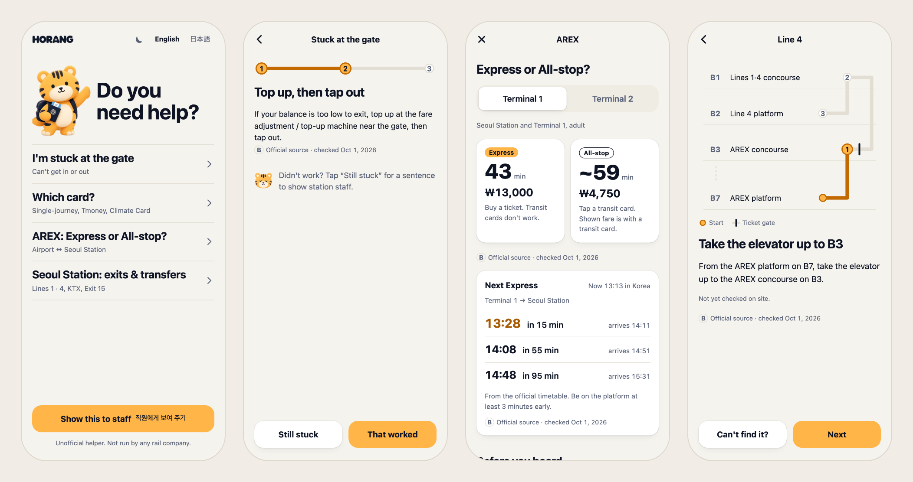
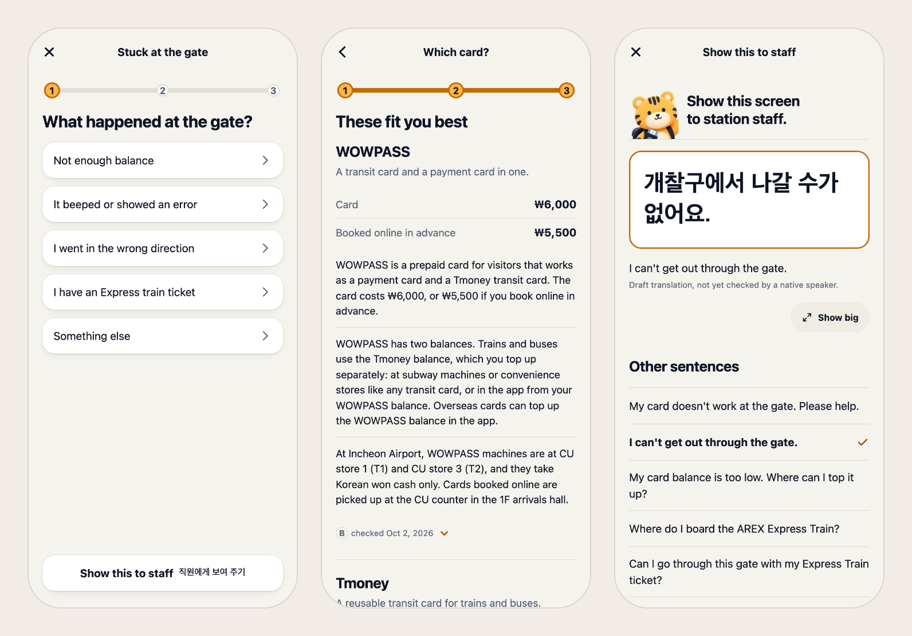
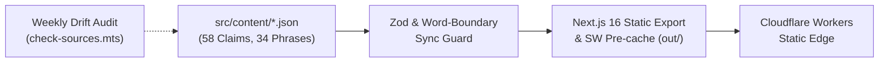
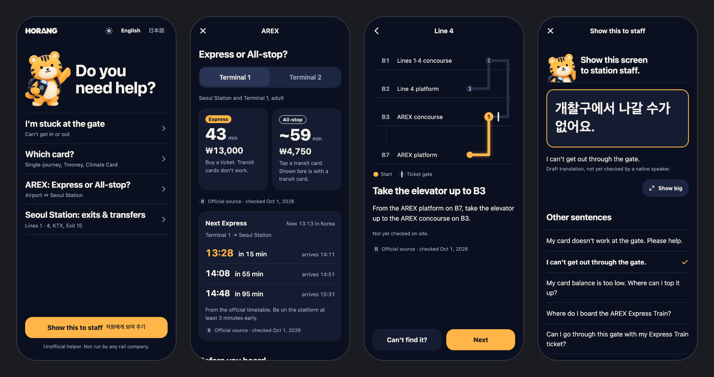

<p align="center">
  <h1 align="center">Horang</h1>
  <p align="center">한국 방문 외국인을 위한 오프라인 여행 안내 웹 앱</p>
  <p align="center"><strong>한국어</strong> | <a href="README.en.md">English</a> | <a href="https://horang.seungwoo7050.workers.dev">horang.seungwoo7050.workers.dev</a></p>
  <p align="center">Next.js 16 (Static Export) | React 19 | TypeScript | Zod | date-fns | nuqs | es-toolkit | Service Worker | Cloudflare Workers | Playwright</p>
</p>


인천공항에 내려 공항철도(AREX)를 타고 서울역에 도착하는 첫 한 시간부터, 홍대입구, 명동, 강남, 성수 시내 이동, 시내버스와 택시 탑승, 식당 키오스크 결제와 알레르기 및 비건 카드, 약국과 분실물 대처, 출국길 도심공항터미널 및 택스리펀드까지 한 단계씩 안내합니다. 7개 언어(`English`, `日本語`, `简体中文`, `繁體中文`, `Français`, `Español`, `Română`)를 지원합니다.

> 비공식 여행 도우미입니다. 철도 운영사(공항철도, 코레일, 서울교통공사)나 인천국제공항공사가 운영하지 않으며 제휴 관계도 없습니다.

<p align="center"></p>

## 주요 기능

| 화면                               | 돕는 일                                                                                                                       |
| ---------------------------------- | ----------------------------------------------------------------------------------------------------------------------------- |
| **개찰구에서 막혔어요**            | 원인(잔액 부족, 오류음, 반대 방향, 직통열차 승차권)을 고르고 해결 방법을 따라가거나 역무원에게 보여 줄 한국어 문장을 엽니다   |
| **어떤 카드?**                     | 현재 위치와 탑승 횟수에 따라 1회용 교통카드, 티머니, 기후동행카드 중 알맞은 카드를 고릅니다                                   |
| **공항철도: 직통 or 일반?**        | 소요 시간과 요금을 나란히 비교하고, 공식 시간표 기준 다음 열차 시각과 출국일 모드를 제공합니다                                |
| **서울역 및 주요 역: 출구와 환승** | 서울역, 홍대입구, 명동, 강남, 성수역에서 무거운 짐이나 유모차를 끌고 이동할 엘리베이터 경로를 층별로 그려 줍니다              |
| **시내버스 및 택시 가이드**        | 버스 앞문 승차와 뒷문 하차 태그 규칙, 30분 환승 할인, 현금 없는 버스 안내 및 택시 기사님 소통 카드를 제공합니다               |
| **식당, 키오스크, 식이제한 카드**  | 키오스크 `010` 번호 입력 우회법, 해외 카드 IC 칩 결제 팁, 알레르기와 할랄 및 비건(육수, 젓갈 포함) 한국어 카드를 제공합니다   |
| **약국, 분실물, 출국 준비**        | 약국 증상별 한국어 카드, 119 통역과 LOST112 분실물 조회, T-Locker/T-Luggage, 서울역 도심공항터미널 및 택스리펀드를 안내합니다 |
| **직원에게 보여 주기**             | 큰 글씨의 짧은 한국어 문장, 전체 화면 "크게 보기" 카드, 1330 관광통역안내전화 연결을 지원합니다                               |

- 처음 방문한 뒤에는 **오프라인에서도 그대로 동작**합니다(서비스 워커 사전 캐시). 시간표와 층별 경로 지도도 모두 포함됩니다.
- 회원가입, 계정, 백엔드 서버, 사용자 추적 없이 순수 정적 사이트로 동작합니다.
- 모든 사실에 출처(A: 현장 실사, B: 공식 출처, C: 여행자 보고)와 마지막 확인 날짜를 함께 기록합니다.
- 라이트 및 다크 모드, 동작 줄이기(Reduced Motion), 강제 색상 모드, 스크린 리더 환경을 모두 검증합니다.

<p align="center"></p>

## 아키텍처와 핵심 설계



### 1. 근거 등급(A/B/C) 분리와 빌드 타임 문구 동기화 가드 (`assert-claim-sync`)

요금, 시간표, 환승 규칙 등 변동 가능성이 있는 58개 사실 데이터([`src/content/claims.json`](src/content/claims.json))와 34개 현장 소통 문장([`src/content/phrases.json`](src/content/phrases.json)), 7개 언어 UI 번역을 분리해 관리합니다. 빌드 타임([`scripts/check-content.mts`](scripts/check-content.mts))에 [`src/content/schema.ts`](src/content/schema.ts)의 Zod 스키마와 정규식 단어 경계 검사(`hasNumber`, `assert-claim-sync`)를 실행하여, `data` 필드의 요금이나 시간 숫자가 7개 언어 번역 문장 전체에 정확히 동일한 값으로 포함되어 있는지 대조하고 불일치 시 빌드를 즉시 중단합니다. 또한 매주 실행되는 출처 감시 스크립트([`scripts/check-sources.mts`](scripts/check-sources.mts), [`scripts/sources-lib.mts`](scripts/sources-lib.mts))가 외부 공식 안내 페이지의 변동을 점검합니다.

### 2. 서버 없는 정적 빌드와 서비스 워커 사전 캐시

공항 지하 승강장이나 로밍 및 유심 개통 전 음영 지역에서도 안내 화면이 즉시 열리도록 별도 API 서버 없이 정적 빌드 산출물(`out/`)만으로 서비스를 구성했습니다. 빌드 직후 실행되는 [`scripts/postbuild-lib.mts`](scripts/postbuild-lib.mts)가 정적 HTML, 시간표, 역사 경로 그래프 전체를 스캔해 콘텐츠 SHA-256 해시 기반의 서비스 워커([`scripts/sw.template.js`](scripts/sw.template.js)) 프리캐시 매니페스트를 생성합니다. 동시에 각 페이지 인라인 스크립트의 SHA-256 해시를 추출해 정적 호스팅 환경에서도 작동하는 엄격한 CSP 보안 헤더(`_headers`)를 자동으로 조립합니다.

### 3. 주요 거점역 층별 엘리베이터 그래프 탐색 (`src/station-map/`)

복잡한 지하철 환승역에서 무거운 캐리어나 유모차를 동반한 여행자가 계단에 막히지 않도록 서울역([`seoul-station.ts`](src/station-map/seoul-station.ts))과 홍대입구, 명동, 강남, 성수역([`hub-stations.ts`](src/station-map/hub-stations.ts))의 층별 이동 노드를 그래프 데이터로 모델링했습니다. [`src/station-map/graph.ts`](src/station-map/graph.ts)의 `validateStation`이 빌드 시점에 노드 중복, 층간 엘리베이터 연결 규칙, 근거 `claim` 참조 무결성을 검증하고, `layoutRoute`가 층별 높이와 SVG 리본 경로 좌표를 사전 계산해 클라이언트 런타임 연산 없이 단면 경로도를 렌더링합니다.

### 4. PR 프리뷰 배포와 번들 용량 검사

저속 로밍 네트워크나 지하 역사에서 첫 방문 시 서비스 워커 프리캐시가 지연되지 않도록 단일 JS 청크 550KB, 전체 프리캐시 용량 14MB, 필수 오프라인 경로(`/`, `/en/gate/`, `/en/card/`, `/en/arex/`, `/en/station/`, `/en/transit/`, `/en/dining/`, `/en/emergency/`, `/en/staff/`, `/sw.js`, `/manifest.webmanifest`) 존재 여부를 검증하는 번들 예산 게이트([`scripts/check-bundle-budget.mts`](scripts/check-bundle-budget.mts))를 두었습니다. Pull Request 단계([`.github/workflows/preview.yml`](.github/workflows/preview.yml))에서는 Cloudflare Workers 프리뷰 별칭(`pr-<번호>`)을 배포해 7개 언어 라우트의 오프라인 캐시 준비도를 점검하고, PR이 닫히면 프리뷰 리소스를 정리합니다.

### 5. 야간 도착 테마의 표면 계층과 접근성 대비

늦은 밤 공항에 도착한 여행자가 눈부심 없이 빠르게 훑어볼 수 있도록 다크 모드를 기준으로 디자인 토큰(`src/app/globals.css`)을 짰습니다.

- **4단계 표면 계층**: `bg`, `surface`, `surface-2`, `raised`의 명도 차이와 `--edge` 음영으로 카드의 위아래를 구분하고, 실선 테두리는 쓰지 않습니다. 호박색 강조는 직원에게 보여주기 버튼, 활성 경로 리본, 현재 단계에만 씁니다.
- **그래픽용과 글자용 호박색 분리**: 어두운 보조 표면(`surface-2`, 티켓 스텁) 위에서 호박색 글자 대비가 4.5:1 아래로 내려가는 문제가 있어, 도형용 `--color-ribbon`과 글자용 `--color-ribbon-text`를 나누고 보조 표면 위 글자에는 `--color-ink`를 쓰도록 바꿨습니다.
- **Windows 강제 색상 모드**: 테두리 대신 쓴 `box-shadow`는 `forced-colors` 모드에서 브라우저가 지워서 카드 경계가 사라집니다. 버튼, 카드, 탭 컴포넌트에 `forced-colors:border-[CanvasText]`를 선언해 시스템 전경색 윤곽선이 남게 했습니다.

## 프로젝트 구성

- **프론트엔드 및 라이브러리**: **Next.js 16** 정적 export(`output: "export"`), 화면 전환에 View Transitions를 활용하는 **React 19**, **Tailwind CSS v4**, **shadcn/ui** 프리미티브, **date-fns**, **nuqs**, **es-toolkit** 유틸리티, 디자인 토큰(`B - Night arrival`)
- **콘텐츠 데이터**: `src/content/claims.json`(근거 등급과 출처가 붙은 사실 58개), `phrases.json`(역무원, 기사, 약국, 식당 소통 문장 34개), `timetables.json`(공항철도 직통열차 공식 시간표), `links.json`(외부 공식 링크 7개 레지스트리)
- **다국어(i18n)**: 7개 언어(`en`, `ja`, `zh-CN`, `zh-TW`, `fr`, `es`, `ro`) 100% 키 동등성 검증
- **호스팅**: Cloudflare Workers 정적 자산(`wrangler.jsonc`), 별도 서버 런타임 없이 `out/` 디렉터리만 배포

```text
src/app/[lang]/     화면 라우트 (gate, card, arex, station, transit, dining, emergency, staff)
src/components/     해결 흐름, 경로 지도, "크게 보기", 브랜드 그래픽, ui/ (shadcn 프리미티브)
src/content/        claims, phrases, timetables, links 데이터와 Zod 스키마
src/station-map/    서울역 및 주요 거점역(홍대입구, 명동, 강남, 성수) 그래프와 경로 배치
src/lib/            다음 열차 시각 계산, URL 흐름 히스토리, 번들 예산 및 프로브 유틸 (devops/)
src/i18n/           7개 언어 번역 사전 (en, ja, zh-CN, zh-TW, fr, es, ro)
scripts/            콘텐츠 검사, 출처 감시, 번들 예산 검사, 서비스 워커 및 CSP 생성, 정적 규칙 검사
e2e/                Playwright E2E 테스트 (흐름, 오프라인, CSP, 접근성, 다음 열차, 브랜드)
```

<p align="center"></p>

## 로컬 실행 및 검증

Node 22 환경이 필요합니다.

```bash
npm ci
npm run dev        # http://localhost:3000
```

| 명령                  | 설명                                                                                                 |
| --------------------- | ---------------------------------------------------------------------------------------------------- |
| `npm run verify:fast` | 콘텐츠 스키마 및 동기화 검사, 린트, 타입 검사, 포맷 검사, 단위 테스트(Vitest), 정적 규칙 및 디자인 토큰 검사 |
| `npm run check:budget` | 정적 산출물(`out/`)의 단일 JS 청크(550KB), 총 프리캐시(14MB), 필수 오프라인 경로 예산 검증 |
| `npm run verify`      | `verify:fast` 실행 후 정적 빌드(`out/`, `sw.js`, `_headers`) 및 Playwright E2E 전체 검증             |
| `npm run deploy`      | 정적 빌드 산출물(`out/`)을 Cloudflare Workers 정적 자산으로 배포                                     |

CI 파이프라인은 모든 Pull Request에서 정적 검사, 빌드, 번들 예산 게이트, Playwright E2E 테스트, Cloudflare Workers PR 프리뷰 배포를 순서대로 실행하며, 모두 통과하면 `main` 브랜치를 Cloudflare Workers에 배포합니다.

## 현재 상태와 검증 범위

8개 이동 및 생활 안내 화면과 7개 언어 번역, 서비스 워커 오프라인 사전 캐시, Cloudflare Workers 정적 배포까지 프로덕션 환경에서 운영 중입니다.

- **데이터 무결성**: 58개 사실 주장(`claims.json`)과 34개 현장 제시 문장(`phrases.json`)을 빌드 타임에 Zod 스키마와 정규식 단어 경계(`assert-claim-sync`)로 대조하며, 매주 월요일 스케줄 워크플로가 외부 공식 출처의 요금과 시각 변동을 감시합니다.
- **남은 현장 과제**: 공식 출처(B 등급)로 기록된 서울역 및 주요 거점역(홍대입구, 명동, 강남, 성수) 엘리베이터 동선의 현장 실사(A 등급 전환)와 다국어 문장의 원어민 감수를 순차적으로 진행하고 있습니다.
