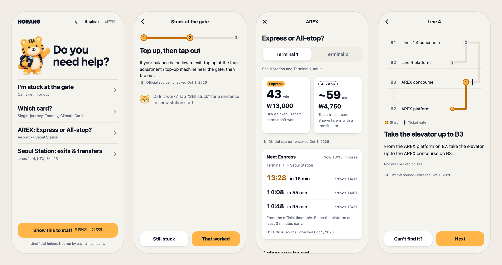
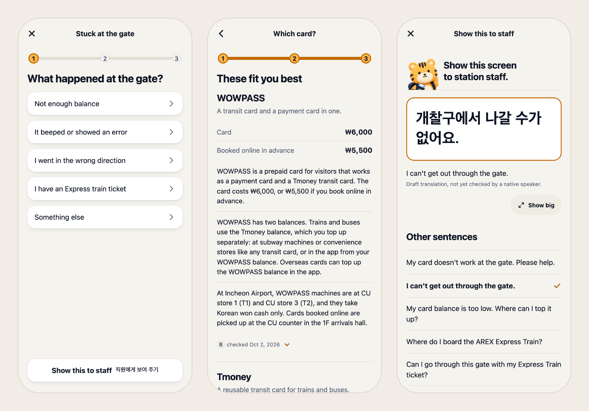
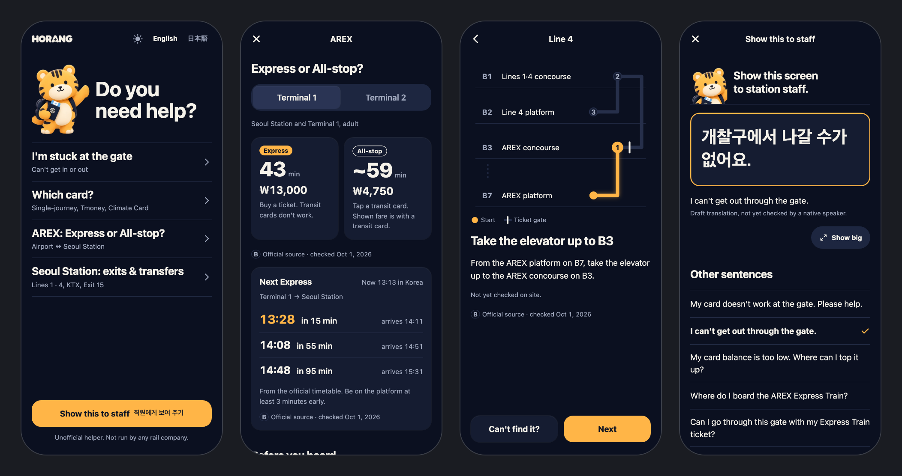

# Horang

**한국어** · [English](README.en.md)


**한국을 여행하는 외국인을 위한 오프라인 여정 동반자.** 인천공항에 내려 공항철도(AREX)를 타고 서울역에 도착하는 첫 한 시간부터, 홍대·명동·강남·성수 시내 이동, 버스·택시 탑승, 식당 키오스크 결제와 알레르기·비건 카드, 약국·분실물·출국길 도심공항터미널·택스리펀드까지 한 단계씩 안내합니다.

**서비스 주소:** https://horang.seungwoo7050.workers.dev · 7개 언어 지원 (`English` · `日本語` · `简体中文` · `繁體中文` · `Français` · `Español` · `Română`)

> 비공식 도우미입니다. 철도 운영사(공항철도, 코레일, 서울교통공사)나 인천공항이 운영하지 않으며 관계도 없습니다.

<p align="center">
  Next.js 16(정적 export) · React 19 · TypeScript · zod · Cloudflare Workers · Playwright<br>
  2026.10 · 커밋 158개 · 테스트 약 180개
</p>

<p align="center"></p>

## 하는 일

| 화면                            | 돕는 일                                                                                                            |
| ------------------------------- | ------------------------------------------------------------------------------------------------------------------ |
| **개찰구에서 막혔어요**         | 원인(잔액 부족, 오류음, 반대 방향, 직통열차 승차권)을 고르고 해결 방법을 따라가거나 직원에게 보여 줄 문장을 엽니다 |
| **어떤 카드?**                  | 지금 있는 곳과 탈 횟수에 따라 1회용 교통카드, 티머니, 기후동행카드 중 하나를 고릅니다                              |
| **공항철도: 직통 or 일반?**     | 소요 시간과 요금을 나란히 보여 주고, 공식 시간표의 다음 열차와 출국일 모드를 제공합니다                            |
| **서울역·주요 역: 출구와 환승** | 서울역·홍대입구·명동·강남·성수역에서 짐을 끌고 갈 엘리베이터 경로를 층별로 그려 줍니다                             |
| **시내버스·택시 가이드**        | 버스 앞문 승차·뒷문 하차 태그 규칙, 30분 환승 할인, 현금 없는 버스 안내 및 택시 기사님 소통 카드                   |
| **식당·키오스크·식이제한 카드** | 키오스크 `010` 번호 우회, 해외 카드 IC 칩 결제 팁, 알레르기·할랄·비건(육수·젓갈 포함) 한국어 카드                  |
| **약국·분실물·출국 준비**       | 약국 증상별 한국어 카드, 119 통역·LOST112 분실물 조회, T-Locker/T-Luggage, 서울역 도심공항터미널·택스리펀드        |
| **직원에게 보여 주기**          | 큰 글씨의 짧은 한국어 문장, 전체 화면 "크게 보기", 1330 관광통역안내전화                                           |

- 처음 방문한 뒤에는 **오프라인에서도 동작**합니다(서비스 워커 사전 캐시). 시간표와 지도도 포함됩니다.
- **가입, 계정, 백엔드, 추적이 없습니다.** 정적 사이트입니다.
- **모든 사실에 출처가 붙습니다.** 각 안내는 A(현장 확인), B(공식 출처), C(여행자 보고) 등급과 마지막 확인 날짜를 갖습니다.
- 라이트·다크 모드, 동작 줄이기, 강제 색상 모드, 스크린 리더를 테스트합니다.

<p align="center"></p>

## 구성

- **Next.js 16** 정적 export(`output: "export"`), 화면 사이 전환에 view transition을 쓰는 **React 19**, **Tailwind CSS v4**와 **shadcn/ui** 프리미티브, 디자인 토큰(`B · Night arrival`).
- **콘텐츠**: `src/content/claims.json`(근거 등급과 출처가 붙은 사실 58개), `phrases.json`(직원·기사·약국·식당용 문장 34개), `timetables.json`(공항철도 직통열차 공식 시간표), `links.json`(7개 외부 링크 레지스트리).
- **i18n**: 7개 언어(`en`, `ja`, `zh-CN`, `zh-TW`, `fr`, `es`, `ro`) 100% 키 동등성.
- **호스팅**: Cloudflare Workers 정적 자산(`wrangler.jsonc`). Worker 스크립트 없이 `out/`만 올립니다.

```
src/app/[lang]/     화면(gate, card, arex, station, transit, dining, emergency, staff)
src/components/     흐름, 경로 지도, "크게 보기", 브랜드 이미지, ui/(shadcn 프리미티브)
src/content/        claims, phrases, timetables, links와 zod 스키마
src/station-map/    서울역 및 주요 거점역(홍대입구·명동·강남·성수) 그래프와 경로 배치
src/i18n/           7개 언어 문구(en, ja, zh-CN, zh-TW, fr, es, ro)
scripts/            콘텐츠 검사, 출처 감시, 서비스 워커·CSP 생성, 하네스 가드(scripts/harness/)
e2e/                Playwright 테스트(흐름, 오프라인, CSP, 접근성, 다음 열차, 브랜드)
```

<p align="center"></p>

## 실행

Node 22가 필요합니다.

```bash
npm ci
npm run dev        # http://localhost:3000
```

| 명령                  | 하는 일                                                                                    |
| --------------------- | ------------------------------------------------------------------------------------------ |
| `npm run verify:fast` | 콘텐츠 검사, 린트, 타입 검사, 포맷 검사, 단위 테스트(Vitest), 하네스·디자인·공개 경계 가드 |
| `npm run verify`      | `verify:fast` → 정적 빌드(`out/`, `sw.js`, `_headers`) → Playwright E2E 전체 검증          |
| `npm run deploy`      | 빌드한 뒤 `out/`을 Cloudflare Workers 정적 자산으로 배포                                   |

CI는 모든 pull request에서 검사 → 빌드 → e2e를 돌리고, 모두 통과하면 `main`을 Cloudflare에 배포합니다.

## 현재 상태

정식 공개 전입니다. 화면, 오프라인 지원, 배포는 끝났습니다. 공개 전에 남은 일:

- 서울역 현장 확인(경로, 출구, 엘리베이터는 현재 공식 출처 기준 B 등급)
- 직원용 한국어 문장과 일본어 문구의 원어민 검토(앱에서는 지금 초안으로 표시)
- 해외 여행자 대상 현장 테스트
