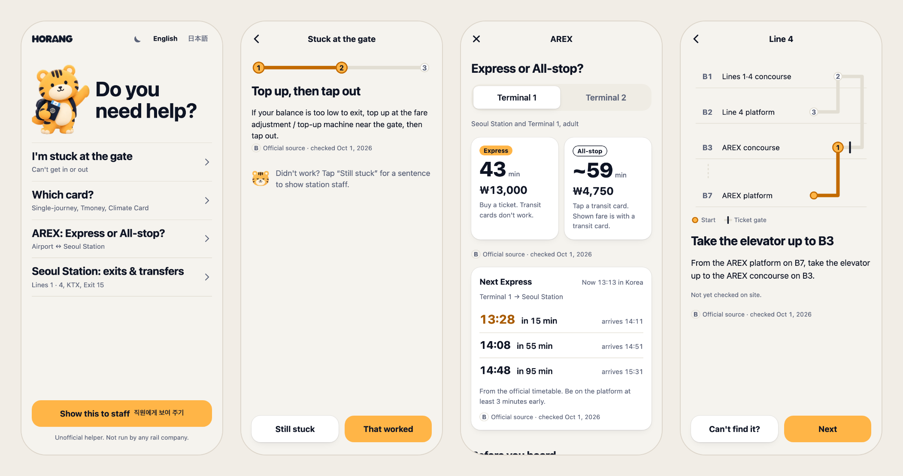
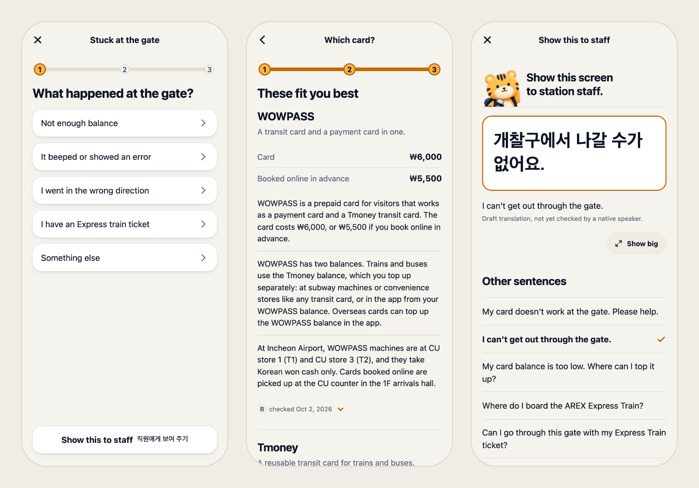
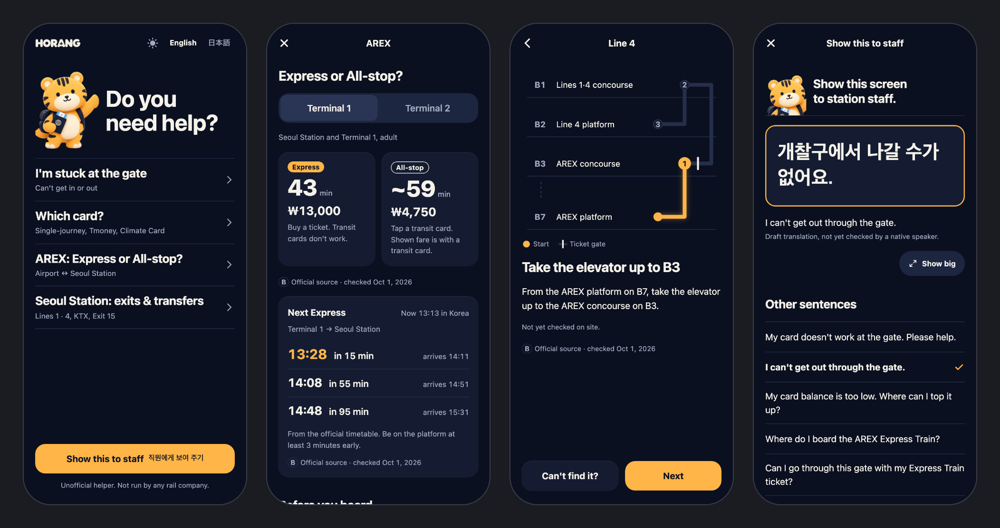

# Horang

**한국어** · [English](README.en.md)


**서울에서 보내는 첫 한 시간을 위한 주머니 안내서.** 인천공항에 내려 공항철도(AREX)를 타고 서울역까지 오는 길에 무언가에 막힙니다. 개찰구가 열리지 않거나, 어떤 카드를 사야 할지, 어떤 열차를 타야 할지 모릅니다. Horang을 열고 막힌 곳을 누르면 호랑이가 한 단계씩 빠져나오게 안내합니다.

**서비스 주소:** https://horang.seungwoo7050.workers.dev · 영어와 일본어

> 비공식 도우미입니다. 철도 운영사(공항철도, 코레일, 서울교통공사)나 인천공항이 운영하지 않으며 관계도 없습니다.

<p align="center">
  Next.js 16(정적 export) · React 19 · TypeScript · zod · Cloudflare Workers · Playwright<br>
  2026.10 · 커밋 158개 · 테스트 약 180개
</p>

<p align="center"></p>

## 하는 일

| 화면                        | 돕는 일                                                                                                            |
| --------------------------- | ------------------------------------------------------------------------------------------------------------------ |
| **개찰구에서 막혔어요**     | 원인(잔액 부족, 오류음, 반대 방향, 직통열차 승차권)을 고르고 해결 방법을 따라가거나 직원에게 보여 줄 문장을 엽니다 |
| **어떤 카드?**              | 지금 있는 곳과 탈 횟수에 따라 1회용 교통카드, 티머니, 기후동행카드 중 하나를 고릅니다                              |
| **공항철도: 직통 or 일반?** | 소요 시간과 요금을 나란히 보여 주고, 공식 시간표의 다음 열차와 출국일 모드를 제공합니다                            |
| **서울역: 출구와 환승**     | 공항철도 승강장에서 1·4호선과 15번 출구까지 짐을 끌고 갈 엘리베이터 경로를 층별로 그려 줍니다                      |
| **직원에게 보여 주기**      | 큰 글씨의 짧은 한국어 문장, 전체 화면 "크게 보기", 1330 관광통역안내전화                                           |

- 처음 방문한 뒤에는 **오프라인에서도 동작**합니다(서비스 워커 사전 캐시). 시간표와 지도도 포함됩니다.
- **가입, 계정, 백엔드, 추적이 없습니다.** 정적 사이트입니다.
- **모든 사실에 출처가 붙습니다.** 각 안내는 A(현장 확인), B(공식 출처), C(여행자 보고) 등급과 마지막 확인 날짜를 갖습니다.
- 라이트·다크 모드, 동작 줄이기, 강제 색상 모드, 스크린 리더를 테스트합니다.

<p align="center"></p>

## 구성

- **Next.js 16** 정적 export(`output: "export"`), 화면 사이 전환에 view transition을 쓰는 **React 19**. CSS 모듈과 디자인 토큰을 쓰고 UI 라이브러리는 쓰지 않습니다.
- **콘텐츠**: `src/content/claims.json`(근거 등급과 출처가 붙은 사실 38개), `phrases.json`(직원용 문장), `timetables.json`(공항철도 직통열차 공식 시간표), `links.json`.
- **i18n**: `src/i18n/en.ts`와 `ja.ts`.
- **호스팅**: Cloudflare Workers 정적 자산(`wrangler.jsonc`). Worker 스크립트 없이 `out/`만 올립니다.

```
src/app/[lang]/     화면(gate, card, arex, station, staff)
src/components/     흐름, 경로 지도, "크게 보기", 브랜드 이미지
src/content/        claims, phrases, timetables, links와 zod 스키마
src/station-map/    서울역 그래프와 경로 배치
src/i18n/           영어와 일본어 문구
scripts/            콘텐츠 검사, 출처 감시, 서비스 워커·CSP 생성, 브랜드 이미지 파생본
e2e/                Playwright 테스트(흐름, 오프라인, CSP, 접근성, 다음 열차, 브랜드)
```

<p align="center"></p>

## 실행

Node 22가 필요합니다.

```bash
npm ci
npm run dev        # http://localhost:3000
```

| 명령                                                       | 하는 일                                                                                    |
| ---------------------------------------------------------- | ------------------------------------------------------------------------------------------ |
| `npm run check`                                            | 린트, 타입 검사, 포맷 검사, 단위 테스트(Vitest)                                            |
| `npm run build`                                            | 콘텐츠 검사(zod) → `out/`으로 정적 export → 서비스 워커와 CSP `_headers` 생성              |
| `node scripts/serve-out.mjs 4173` 뒤 `npx playwright test` | 빌드한 사이트를 Cloudflare와 같은 방식으로 띄워 e2e 테스트(빌드할 때마다 서버를 다시 띄움) |
| `npm run deploy`                                           | 빌드한 뒤 `out/`을 Cloudflare Workers 정적 자산으로 배포                                   |

CI는 모든 pull request에서 검사 → 빌드 → e2e를 돌리고, 모두 통과하면 `main`을 Cloudflare에 배포합니다.

## 현재 상태

정식 공개 전입니다. 화면, 오프라인 지원, 배포는 끝났습니다. 공개 전에 남은 일:

- 서울역 현장 확인(경로, 출구, 엘리베이터는 현재 공식 출처 기준 B 등급)
- 직원용 한국어 문장과 일본어 문구의 원어민 검토(앱에서는 지금 초안으로 표시)
- 해외 여행자 대상 현장 테스트
